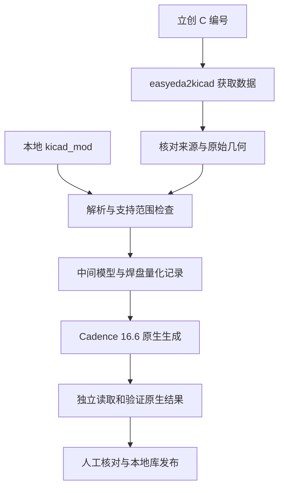

# 程序结构

[返回首页](../README.md)

程序把获取数据、转换和独立验证分开，任务目录保留每个阶段的证据。

## 模块职责

| 模块 | 职责 |
| --- | --- |
| `lc2a.py` | 命令入口、几何解析、任务建立和原生构建 |
| `easyeda_raw.py` / `kicad_source.py` | 原始数据规范化与输入约束 |
| `source_graphics.py` | 上游图形清点、几何复核和标准化 |
| `reviewed_profiles.py` | 指定器件的厂家图纸修正规则和 PDF 哈希绑定 |
| `verify.py` | 独立验证任务和原生读取流程 |
| `verify_upstream.py` / `verify_graphics_source.py` / `verify_pin_ids.py` | 从来源重新核对数据身份、图形、引脚编号 |
| `pad_summary.py` / `board_sides.py` | 焊盘报告及上下板面、旋转等几何关系 |
| `native_runtime.py` / `native_faults.py` / `native_journal.py` | 原生子进程、超时、错误和日志检查 |
| `library.py` / `windows_lock.py` | 本地库事务、并发约束、试验收据及恢复 |
| `selftest.py` | 原本机完整测试与集成测试记录入口 |
| `scripts/run_portable_tests.py` | 公开源码包可复现的独立测试子集入口 |

## 为什么不能只看“程序运行成功”

子进程退出码为零，并不能证明引脚、焊盘或内部层都正确。程序除了检查运行状态，还检查生成文件、重新打开后的数据和原生日志。

`convert` 的 `built_and_geometry_checked` 是构建阶段状态。独立 `verify` 还会核对保留的源文件、参数、程序与文件哈希以及原生读回结果，避免只用中间模型证明自身正确。

每次任务使用独立目录；原生临时工作区和子进程也按任务隔离。失败时保留诊断，不把缺少证据写成“验证通过”。这些检查仍具有明确边界，见 [支持范围](supported-features.md)。
